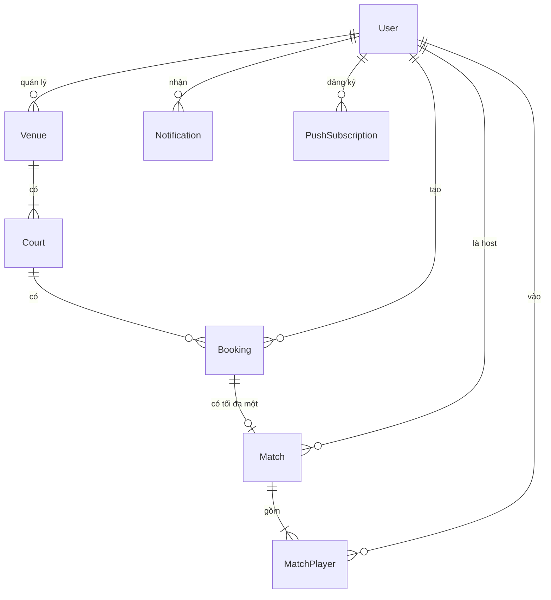
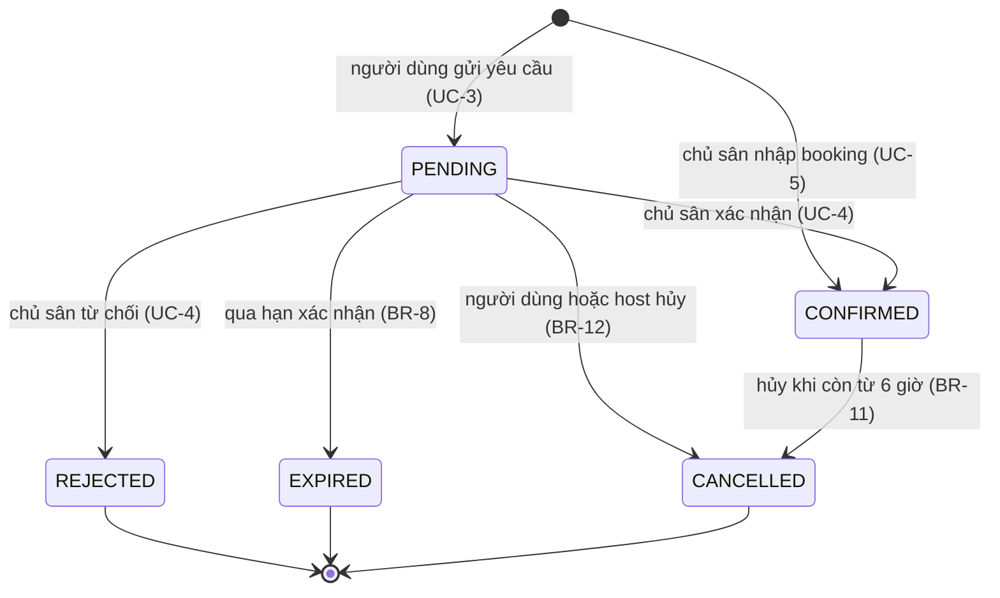
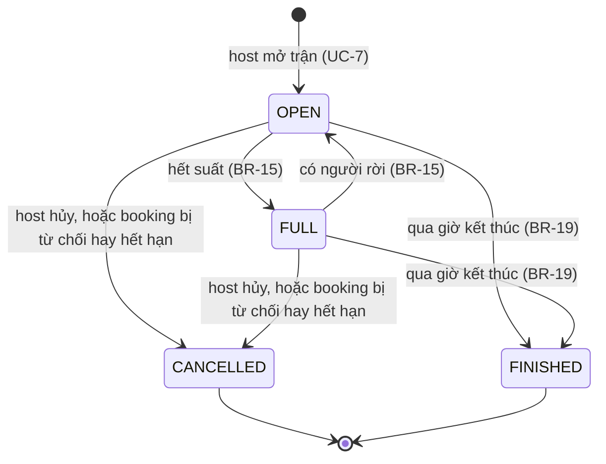

# Mô hình

Nguồn: `data-dictionary.md`, `business-rules.md`, `use-cases.md`.

## ERD

Figure 1. Quan hệ giữa các bảng

## Trạng thái của booking

Figure 2. Trạng thái của booking

`PENDING` và `CONFIRMED` giữ giờ trên sân (BR-1). Ba trạng thái còn lại trả giờ đó về trống.

## Trạng thái của trận

Figure 3. Trạng thái của trận
