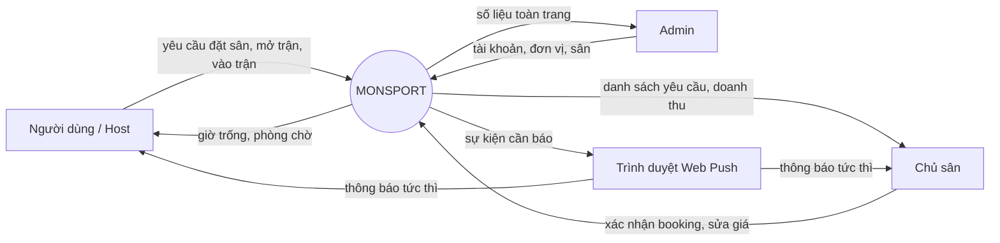
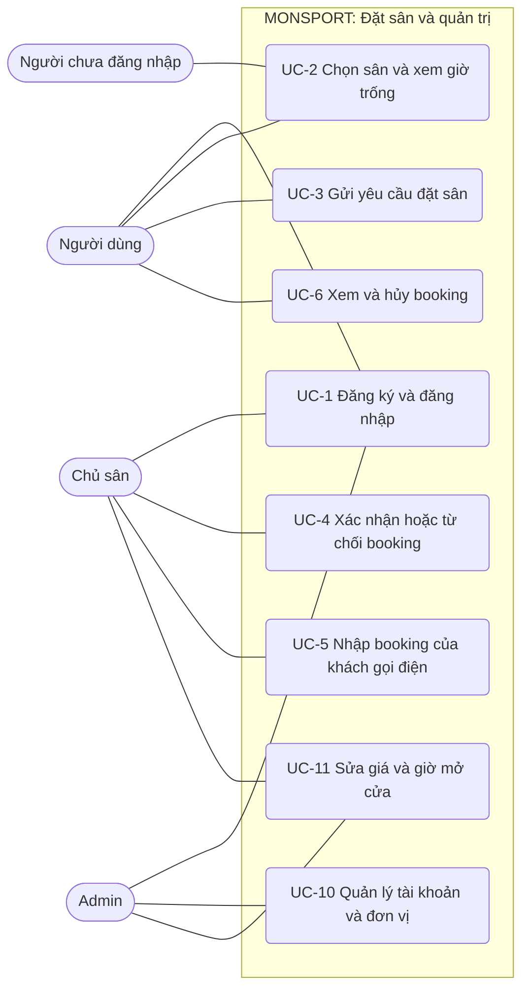
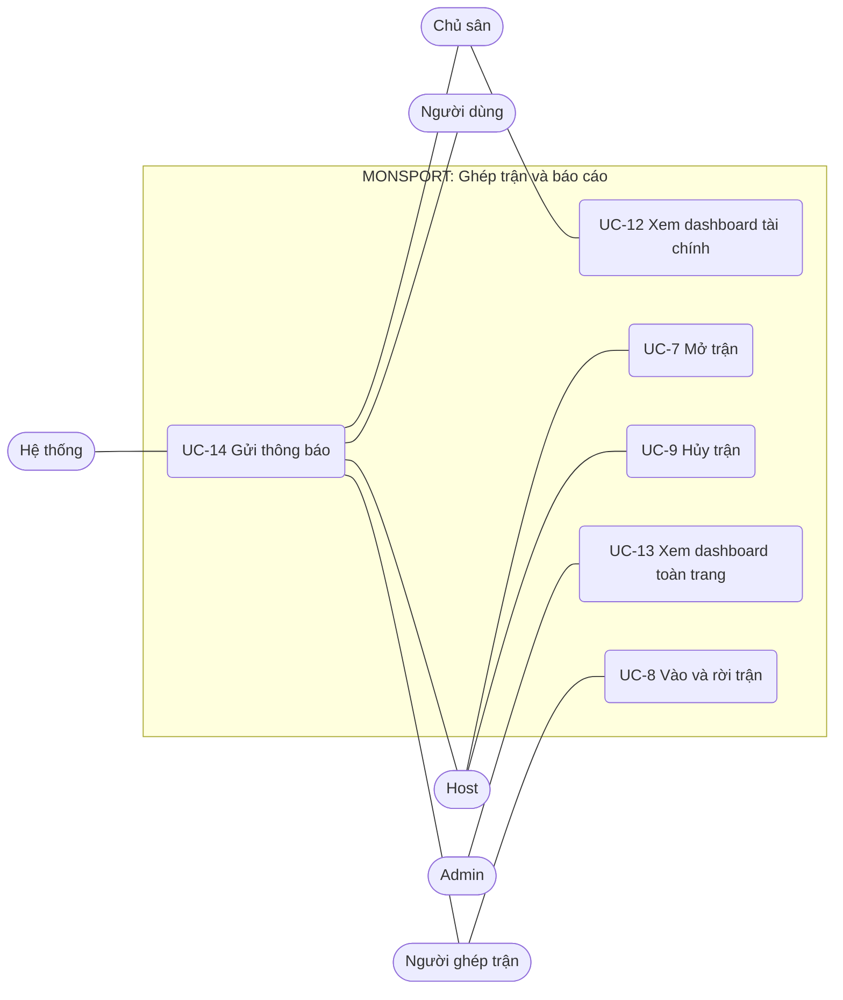
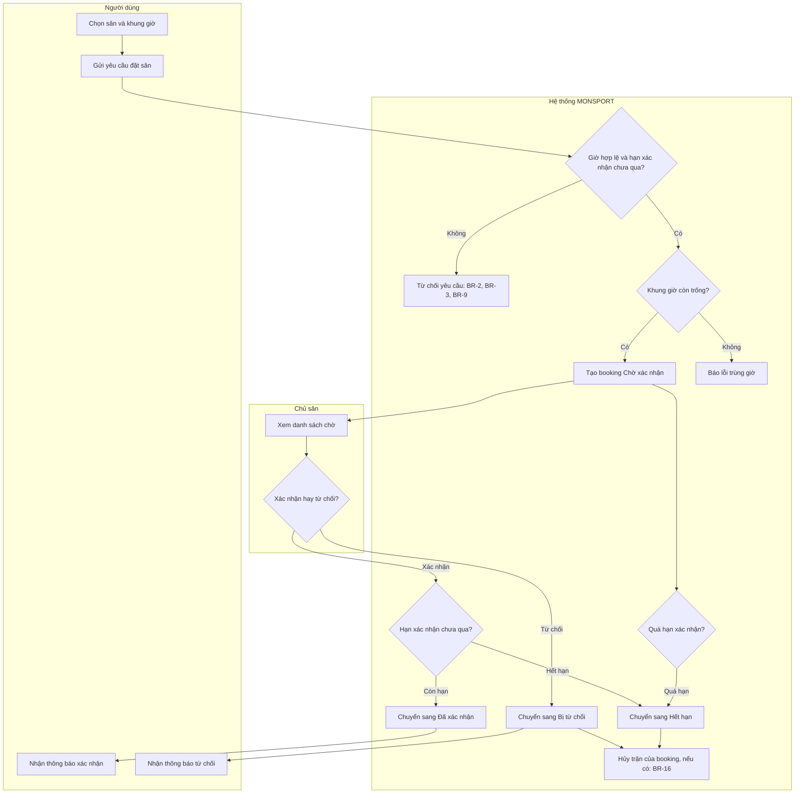
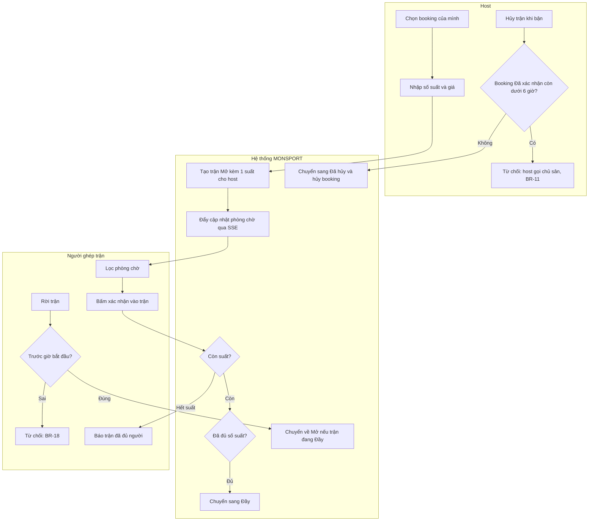
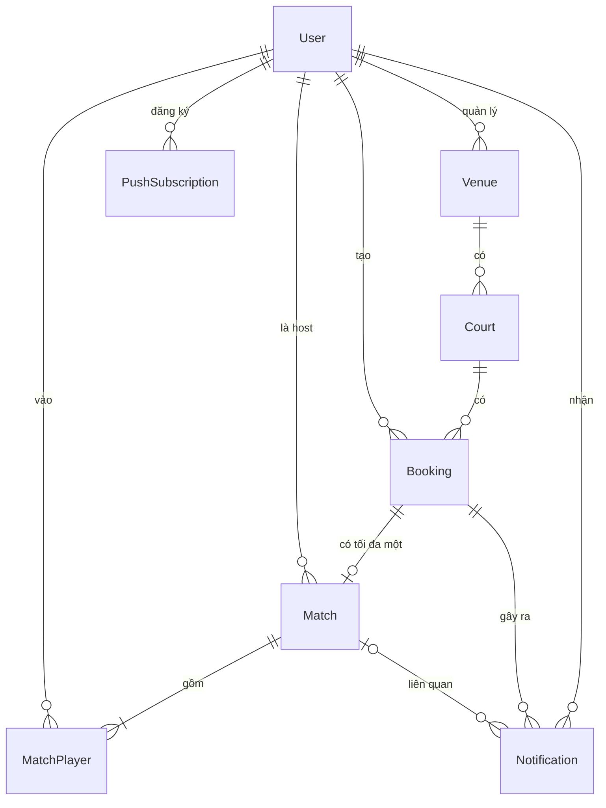
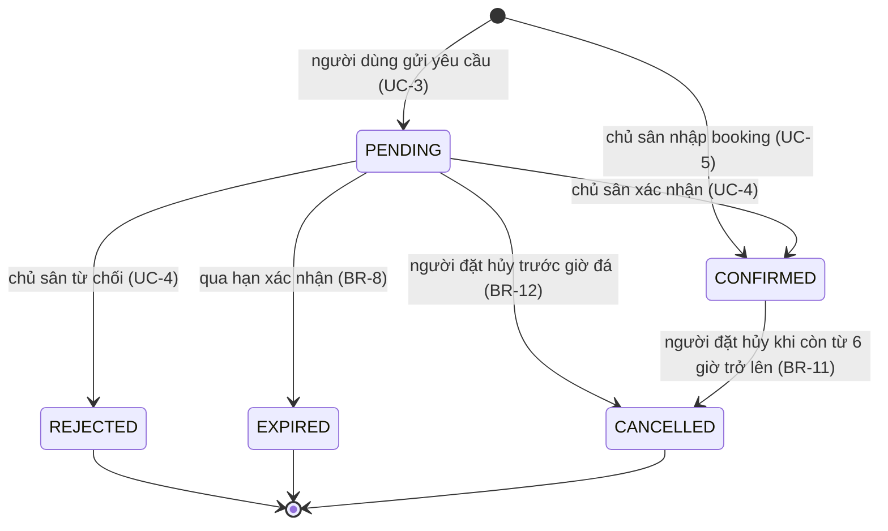
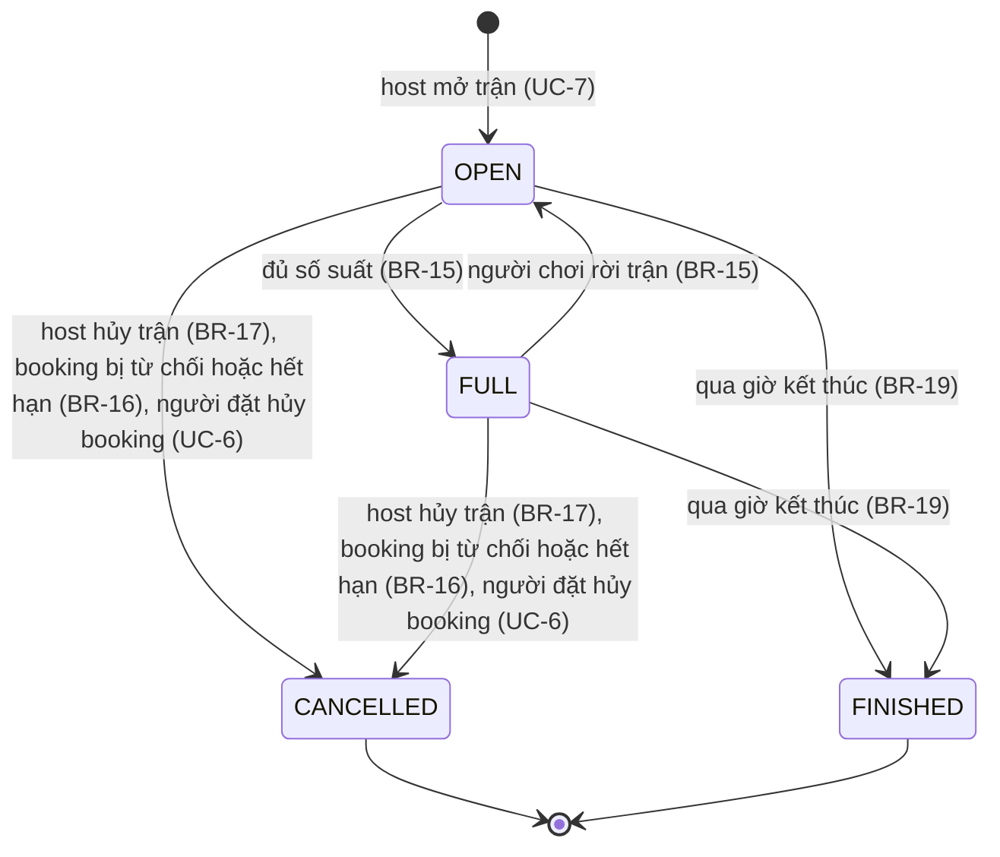
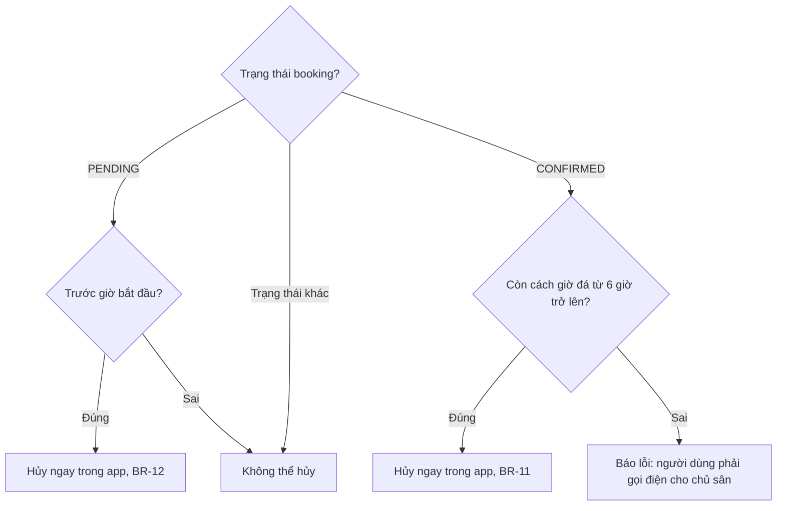

# Mô hình hệ thống

Tài liệu này tổng hợp các mô hình trực quan cho hệ thống MONSPORT bản đầu. Nguồn dữ liệu xuất phát từ `intake-monsport-v1.md`, `use-cases.md`, `business-rules.md` và `data-dictionary.md`.

## Sơ đồ ngữ cảnh

Sơ đồ ngữ cảnh thể hiện ranh giới của hệ thống MONSPORT và các luồng thông tin với tác nhân bên ngoài (xem Figure 1).

Figure 1. Sơ đồ ngữ cảnh của MONSPORT bản đầu

Ý nghĩa: hình tròn = hệ thống. Hình chữ nhật = tác nhân bên ngoài. Mũi tên = luồng dữ liệu.

## Sơ đồ use case

Hệ thống phục vụ người dùng, chủ sân và admin, và có một nhóm tác vụ tự động. Sơ đồ phân chia thành hai phần để đảm bảo độ rõ ràng (xem Figure 2 và Figure 3).

Figure 2. Sơ đồ use case: đặt sân và quản trị

Ý nghĩa: hình elip = vai trò người dùng. Khung viền tròn = use case. Khung chữ nhật = ranh giới hệ thống.

Figure 3. Sơ đồ use case: ghép trận và báo cáo

Ý nghĩa: Host và Người ghép trận là vai trò của Người dùng. Hình elip = vai trò người dùng. Khung viền tròn = use case. Khung chữ nhật = ranh giới hệ thống.

## Quy trình nghiệp vụ

### Quy trình đặt sân và xác nhận booking

Quy trình đặt sân diễn ra giữa người dùng, hệ thống và chủ sân (xem Figure 4). Hệ thống khóa sân tức thì để ngăn chặn hai người cùng đặt một giờ (BR-1).

Figure 4. Sơ đồ luồng bơi: quy trình đặt sân và xác nhận booking

Ý nghĩa: khung lớn = vai trò tham gia. Hình chữ nhật = bước thực hiện. Hình thoi = quyết định rẽ nhánh.

### Quy trình mở trận và ghép người chơi

Host có một booking hợp lệ được phép mở trận để tìm người chơi ghép trong phòng chờ (xem Figure 5). Người ghép trận tham gia trực tiếp mà không cần host phê duyệt.

Figure 5. Sơ đồ luồng bơi: quy trình mở và ghép trận

Ý nghĩa: khung lớn = vai trò tham gia. Hình chữ nhật = bước thực hiện. Hình thoi = quyết định rẽ nhánh.

## Sơ đồ quan hệ thực thể

Cơ sở dữ liệu gồm tám thực thể chính phục vụ đặt sân, ghép trận và thông báo (xem Figure 6). Bảng `AuthThrottle` đứng riêng và không có quan hệ với bảng nào.

Figure 6. Quan hệ giữa các bảng dữ liệu

Ý nghĩa: thể hiện các quan hệ 1-1, 1-n giữa các bảng. Chi tiết các cột nằm trong Từ điển dữ liệu.

## Vòng đời trạng thái

### Trạng thái của booking

Một booking chuyển đổi giữa năm trạng thái trong suốt vòng đời của mình (xem Figure 7). Chỉ có trạng thái `PENDING` và `CONFIRMED` là chiếm giữ khung giờ trên sân (BR-1).

Figure 7. Vòng đời trạng thái của booking

Ý nghĩa: hình hộp bo góc = trạng thái. Mũi tên kèm nhãn = hành động hoặc điều kiện gây đổi trạng thái.

Bảng chuyển đổi trạng thái của booking:

| Trạng thái hiện tại | PENDING | CONFIRMED | REJECTED | EXPIRED | CANCELLED |
|---|---|---|---|---|---|
| **Chờ xác nhận (PENDING)** | — | Chủ sân xác nhận (UC-4) | Chủ sân từ chối (UC-4) | Qua hạn xác nhận (BR-8) | Người đặt tự hủy (BR-12) |
| **Đã xác nhận (CONFIRMED)** | — | — | — | — | Hủy khi còn từ 6 giờ trở lên (BR-11) |
| **Bị từ chối (REJECTED)** | — | — | — | — | — |
| **Hết hạn (EXPIRED)** | — | — | — | — | — |
| **Đã hủy (CANCELLED)** | — | — | — | — | — |

### Trạng thái của trận

Một trận trong phòng chờ chuyển đổi giữa bốn trạng thái tùy theo số suất và thời gian (xem Figure 8).

Figure 8. Vòng đời trạng thái của trận

Ý nghĩa: hình hộp bo góc = trạng thái. Mũi tên kèm nhãn = nguyên nhân đổi trạng thái.

Bảng chuyển đổi trạng thái của trận:

| Trạng thái hiện tại | OPEN | FULL | CANCELLED | FINISHED |
|---|---|---|---|---|
| **Mở (OPEN)** | — | Người chơi vào đủ suất (BR-15) | Host hủy trận (BR-17), booking bị từ chối hoặc hết hạn (BR-16), người đặt hủy booking (UC-6) | Quá giờ kết thúc (BR-19) |
| **Đầy (FULL)** | Người chơi rời trận (BR-15) | — | Host hủy trận (BR-17), booking bị từ chối hoặc hết hạn (BR-16), người đặt hủy booking (UC-6) | Quá giờ kết thúc (BR-19) |
| **Đã hủy (CANCELLED)** | — | — | — | — |
| **Đã đá xong (FINISHED)** | — | — | — | — |

## Cây quyết định xử lý hủy booking

Khi người dùng muốn hủy booking, hệ thống kiểm tra trạng thái và thời gian còn lại (xem Figure 9). Quy tắc BR-11 và BR-12 quyết định booking được tự hủy hay phải gọi điện cho chủ sân.

Figure 9. Cây quyết định: xử lý yêu cầu hủy booking

Ý nghĩa: hình thoi = điều kiện rẽ nhánh. Hình chữ nhật = kết quả xử lý của hệ thống.

## Ma trận CRUD

Ma trận CRUD liên kết các use case với các thực thể trong cơ sở dữ liệu. Cột `PushSubscription` chỉ có UC-14 đọc và xóa. Chưa có use case nào tạo bảng này. Việc chuyển booking sang "Hết hạn" (BR-8) không thuộc use case nào. Việc đó ghi `Booking` và `Match` như UC-4 từ chối.

| Use case | User | Venue | Court | Booking | Match | MatchPlayer | Notification | PushSubscription |
|---|---|---|---|---|---|---|---|---|
| **UC-1 Đăng ký và đăng nhập** | C, R | — | — | — | — | — | — | — |
| **UC-2 Chọn sân và xem giờ trống** | — | R | R | R | — | — | — | — |
| **UC-3 Gửi yêu cầu đặt sân** | R | R | R | C | — | — | C | — |
| **UC-4 Xác nhận hoặc từ chối booking** | R | R | R | R, U | U | R | C | — |
| **UC-5 Nhập booking của khách gọi điện** | R | R | R | C, R | — | — | — | — |
| **UC-6 Xem và hủy booking** | R | R | R | R, U | U | R | C | — |
| **UC-7 Mở trận** | R | — | — | R | C | C | — | — |
| **UC-8 Vào và rời trận** | R | — | — | R | R, U | C, U | — | — |
| **UC-9 Hủy trận** | R | — | — | R, U | U | R | C | — |
| **UC-10 Quản lý tài khoản và đơn vị** | C, R, U | C, R, U | C, R, U | — | — | — | — | — |
| **UC-11 Sửa giá và giờ mở cửa** | R | R, U | R, U | — | — | — | — | — |
| **UC-12 Xem dashboard tài chính** | R | R | R | R, U | — | — | — | — |
| **UC-13 Xem dashboard toàn trang** | R | R | R | R | R | — | — | — |
| **UC-14 Gửi thông báo** | R | — | — | R | R | R | C, R | R, D |
